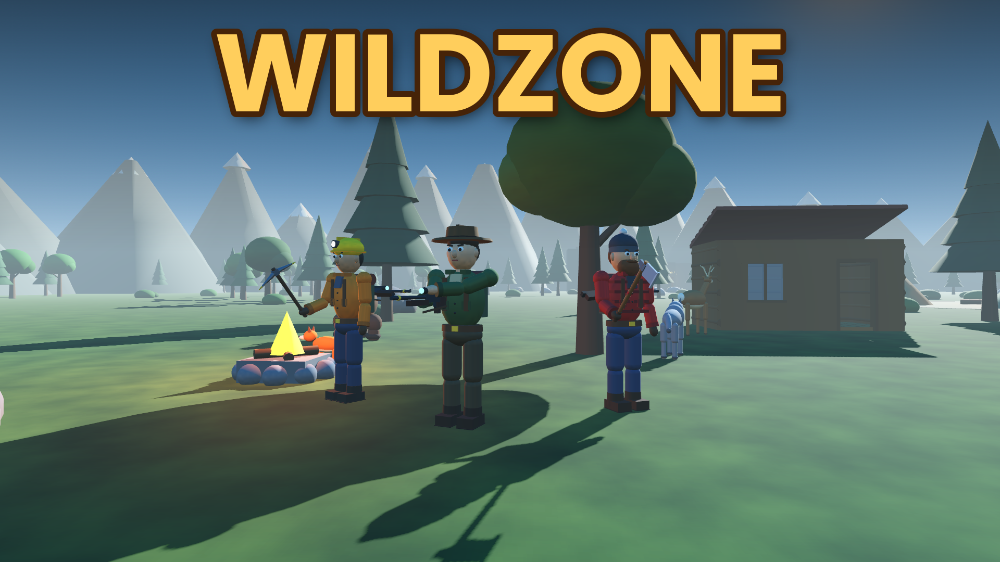

# WILDZONE

**Play now in your browser:** https://botsabin.github.io/WildZone/

A co-op wilderness game made with Godot 4.3: hunt deer, wolves and bears, mine stone, iron and gold, chop trees, build cabins and bridges, and sell your loot to Trader Ion. Level up to 99 with bonuses on every level.

## Play with friends
1. Open the game, pick a name and a character, press **HOST ONLINE GAME**.
2. You get a 5-letter **room code** and an invite link (copied to your clipboard).
3. Friends open the link (or the game and type the code next to **JOIN**).
4. Keep your tab open: your browser is the host and saves the world.

Players connect directly to each other (WebRTC). A free public MQTT broker is only used to exchange the connection details when someone joins. On some strict networks (some school/company networks or mobile carriers) a direct connection isn't possible.

## Controls
| Key | Action |
| --- | --- |
| WASD / Shift / Space | move / sprint / jump |
| 1–4 | rifle, pickaxe, axe, build hammer |
| Left mouse | shoot / mine / chop / build |
| Right mouse | remove a building piece (build mode) |
| B / mouse wheel, R | change building piece, rotate |
| E | interact (skin animals, trade) |
| I or Tab | inventory & character |
| H | use a medkit |
| T / Enter | chat |
| M | big map (minimap is top-right) |
| Esc | menu: resume or save & exit |

## Playing on a phone
Open the link in Chrome (Android) or Safari (iPhone) and turn the phone sideways. The left thumb moves (floating joystick, push to the edge to run), drag anywhere on the right to look around. Buttons: **FIRE / MINE / CHOP / BUILD** (changes with the tool), **SWAP** tool, **JUMP**, **RUN**, **E** interact, **BAG**, **+HP**, **CHAT**, **MENU** (save & exit); tap the minimap for a big map; in build mode **NEXT**, **ROT** and **DEL**. Tip: "Add to Home screen" (Chrome menu → Install app / Add to Home screen) — the icon then opens the game full screen and already turned sideways.

## Project layout
- `scripts/` — all game code (GDScript). The game world, characters and animals are built from code, no imported models.
- `docs/` — the exported web build served by GitHub Pages.
- `store_assets/` — cover images for game portals.
- `CRAZYGAMES_UPLOAD.md` — how to publish on CrazyGames.

## Updating the web version
For GitHub Pages export the **"Web (GitHub Pages app)"** preset (installable phone app: home-screen icon opens full screen in landscape) to `build/pages/`, copy those files into `docs/` and push. For CrazyGames export **"Web (CrazyGames)"** to `build/web/` and zip its contents.

## Other ways to play
- **Desktop, same network:** run the project in Godot and press **HOST GAME**; friends join with your local IP.
- **Dedicated server:** `godot --headless --path . -- --server --port 24560`, then join with `ws://IP` or `wss://address`.
